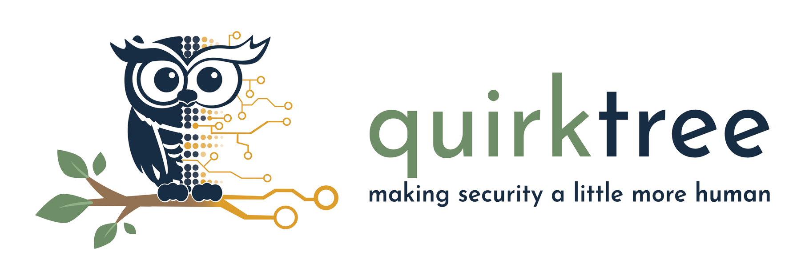

<picture>
  <source media="(prefers-color-scheme: dark)" srcset="https://github.com/quirktree/.github/raw/main/profile/images/quirktree-banner-dark-transparent.png">
  
</picture>

# Open source from Quirktree

Quirktree, LLC helps organizations of every size make sense of their security and privacy obligations through compliance support, technical consulting, and training. This is where our open source work lives: browse [all repositories](https://github.com/orgs/quirktree/repositories).

## Get in touch

- **Questions or bugs in a project:** open an issue in that repository so the answer stays public and searchable.
- **Security vulnerabilities in our code:** tell us privately through our [contact form](https://www.quirktree.com/contact) rather than opening a public issue.
- **Privacy complaints about Quirktree's services:** follow our [privacy complaint procedure](https://www.quirktree.com/report-a-concern).
- **Working with us:** [contact us](https://www.quirktree.com/contact) about compliance support or technical consulting.
- **Training:** browse our [cybersecurity courses](https://www.quirktree.com/quirktree-courses).

Visit [quirktree.com](https://www.quirktree.com) to learn more.

---

Each repository is licensed separately. See the `LICENSE` file in the repository you're using.